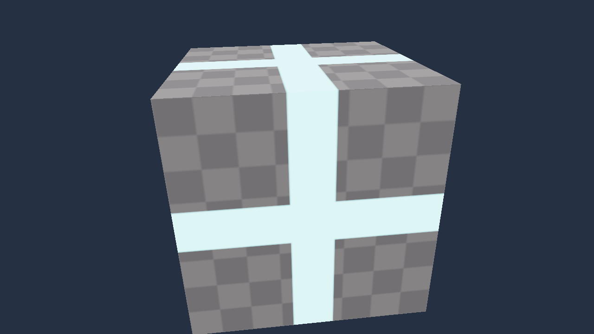
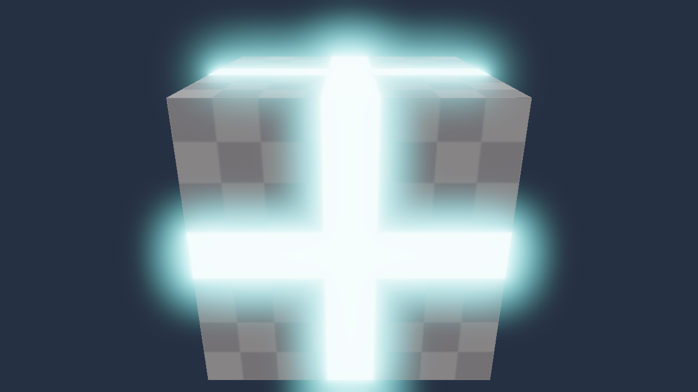

# Bloom e Efeitos de Pós-Processamento em Tempo Real
## Protótipo Funcional Completo em Vulkan (C++20)

Este repositório contém a pesquisa teórica e a implementação prática completa da técnica de pós-processamento de **Bloom em Tempo Real** sob a API gráfica **Vulkan**, desenvolvida para a disciplina de Computação Gráfica e Processamento de Imagens da Universidade Católica de Santos.

A aplicação executa o pipeline completo de **11 passes e 5 render passes**, integrando texturas HDR de 16 bits (`VK_FORMAT_R16G16B16A16_SFLOAT`), pirâmide de reduções e ampliações com *Additive Blending* e mapeamento tonal (*Tone Mapping*) de Reinhard.

---

### Demonstração Visual Comparativa

| Sem Bloom (LDR Convencional) | Com Bloom Ativo (Pipeline Vulkan) |
| :---: | :---: |
|  |  |
| *Corte abrupto sem dispersão de luz* | *Sangramento de luz suave (Light Bleeding)* |

---

### Organização do Repositório

O projeto está dividido em duas partes principais na raiz:

```
├── teoria/                             # Documentação acadêmica e artigos em LaTeX
│   ├── main.tex                        # Artigo completo integrando todas as entregas
│   ├── entrega2.tex                    # Desenho técnico da arquitetura do pipeline Vulkan
│   ├── entrega3.tex                    # Pseudocódigo dos shaders em GLSL
│   ├── entrega4.tex                    # Boilerplate e inicialização da API Vulkan
│   ├── entrega5.tex                    # Protótipo funcional completo e validação
│   ├── Bloom e Efeitos de Pós... .pdf   # Artigo compilado em PDF
│   ├── diagrama.png / .svg / .drawio   # Diagrama completo dos 11 passes e barreiras
│   ├── referencias.bib                 # Referências bibliográficas (BibTeX)
│   ├── figura1.jpg / figura2.jpg       # Análises em jogos (Portal RTX e Cyberpunk 2077)
│   └── shaders/                        # Fontes dos shaders para compilação direta do LaTeX
│
├── codigo/                             # Implementação em C++20 com Vulkan
│   ├── CMakeLists.txt                  # Arquivo de build do CMake (C++20)
│   ├── compilar_shaders.sh             # Script para compilação de GLSL para SPIR-V (.spv)
│   ├── captura_bloom_ativo.png         # Comprovação visual da GPU com Bloom
│   ├── captura_bloom_desativado.png    # Comprovação visual da GPU sem Bloom
│   ├── shaders/                        # Shaders GLSL (#version 450) e pasta spv/
│   │   ├── scene.vert / .frag          # Passe 0: Renderização da cena 3D e cálculo HDR
│   │   ├── fullscreen.vert             # Passes 1 a 10: Triângulo procedural de tela cheia
│   │   ├── bright.frag                 # Passe 1: Isolamento de altas luzes (Soft Knee)
│   │   ├── downsample.frag             # Passes 2 a 5: Filtro de 13 amostras e redução piramidal
│   │   ├── upsample.frag               # Passes 6 a 9: Filtro tenda 3x3 e mistura aditiva
│   │   ├── composite.frag              # Passe 10: Composição e Tone Mapping de Reinhard
│   │   └── teste.frag                  # Shader de teste com gradiente e núcleo incandescente
│   ├── src/                            # Módulos em C++20 (SOLID & Nomenclatura em Português)
│   │   ├── Comum.hpp                   # Tipos utilitários e macros fail-fast
│   │   ├── Janela.hpp / .cpp           # Janela GLFW e superfície Vulkan
│   │   ├── DispositivoVulkan.hpp / .cpp# Instância, validação, GPU física e dispositivo lógico
│   │   ├── GerenciadorSwapchain.hpp/.cpp # Swapchain e Image Views dinâmicas
│   │   ├── CarregadorShader.hpp / .cpp # Leitura de binários SPIR-V e VkShaderModules
│   │   ├── RecursosGraficos.hpp / .cpp # Imagens HDR, profundidade, amostradores e texturas
│   │   ├── CenaGeometrica.hpp / .cpp   # Geometria 3D (cubo com normais, UVs e UBO da Câmera)
│   │   ├── PipelineBloom.hpp / .cpp    # 5 Render Passes, 5 Pipelines e 11 Barreiras
│   │   ├── AplicacaoVulkan.hpp / .cpp  # Loop principal, delta time e controles interativos
│   │   └── main.cpp                    # Ponto de entrada com tratamento de exceções
│   └── third_party/                    # Cabeçalhos do Vulkan SDK (Vulkan-Headers)
│
├── .gitignore                          # Regras para ignorar binários e temporários no Git
└── README.md                           # Este documento
```

---

### Como Compilar e Executar o Código

Dentro da pasta `codigo/`:

```bash
cd codigo

# 1. Configurar e Compilar
cmake -B build
cmake --build build

# 2. Executar a Janela Interativa
./build/BloomVulkan

# Ou executar o modo teste que salva imagens comparativas:
./build/BloomVulkan --quadros 60
```

---

### Controles Interativos (Em Tempo Real)

- **`[ESPAÇO]`:** Alterna instantaneamente entre **Bloom ATIVADO** e **Bloom DESATIVADO**;
- **`[P]`:** Pausa e retoma a rotação contínua do cubo tridimensional;
- **`[+]` / `[=]`:** Aumenta a intensidade do brilho luminoso ($\alpha$);
- **`[-]`:** Diminui a intensidade do brilho luminoso;
- **`[ESC]`:** Encerra a aplicação de forma limpa.
